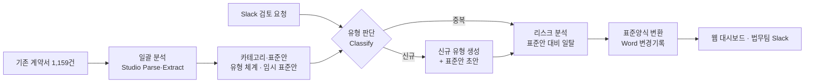

# 처리 흐름과 설계

## 전체 흐름

신규 유형도 표준안 초안을 만든 뒤 **리스크 분석 → 표준양식 변환**을 반드시 거친다.
신규 유형의 표준안은 법무팀 확정 전까지 `draft` 상태로 표시한다.

## Studio 기능과 자체 로직 구분 (v2: 어댑트 플레이북 기준, 추론 모델 solar-pro4)

| 기능 | Studio API | 자체 구현 |
|---|---|---|
| 계약서 읽기·메타데이터 | `document-parse`, `information-extract`(solar-pro4) | – |
| 결과 적재 | `export`(collection mode) → Collection | – |
| 분류 기준 | – (어댑트 taxonomy.json 49종 + 플레이북 INDEX 결정트리를 그대로 사용) | 상위 5종 + 기타 범위 정의 |
| 유형 판단 | `document-classify`(6개 클래스) → `instruct`(Rationale: 49종 1·2순위, 포함/제외 신호와 원문 발췌) | 두 판단의 일치·신호 수로 **근거 수준**(신뢰도 대체) 계산, 엇갈리면 근거 분석 쪽을 제안 |
| 분류 확정 | – | 승인 / 다른 유형으로 / 기타로 (바꾸면 Studio로 재검토) |
| 리스크 분석 | `instruct`(유형별 Config에 플레이북·공통 포지션·표준 원문 고정) → `validate` | 항목별 사실 플래그 → 결론(수정 필요/변호사 확인/참고) 규칙 |
| 변호사 확인 | – | 요청·답변 기록, 질문 목록 복사 |
| 표준양식 변환·변경기록 | – | 어댑트 표준 원본 .docx 위에 변경 추적·메모 |
| Slack 연동, 화면, 저장 | – | Slack 앱, Next.js, Postgres |

## Studio 리소스 규칙

- Config는 생성 후 steps를 바꿀 수 없다. 변경은 `studio/` 정의를 고쳐 **새 Config 버전**으로 만든다.
- Agent·Config·Collection ID는 DB `studio_resources`에 저장하고 하드코딩하지 않는다.
- Job은 `background: true`로 실행하고 `GET /v2/responses/{id}`를 폴링한다(`in_progress` → `completed|failed|cancelled`).

## v2 구현 메모 (2026-11-10)

### 분류 기준과 검토 범위
- 어댑트 전달자료(ADAPT_업스테이지_전달자료_261109)의 `taxonomy.json`(49종)과 `03_플레이북_지식베이스`를 기준으로 한다. 자료는 저장소에 넣지 않고(`data/adapt/`), DB 적재 묶음으로만 배포한다.
- 어댑트 추정 계약 수 상위 5종(inf_paid_en, tw_inf, adc_crt_kr, inf_ttaff_en, adc_agy_kr. 전체의 약 80%)은 플레이북으로 조항별 검토,
  나머지 44종은 **기타**로 묶어 `01_COMMON_POSITIONS`(전 표준 공통 기준)까지만 검토한다.
- tw_inf는 어댑트 표준이 없는 유형이라 공통 기준 + INF-PAID-EN-01(참고) 항목으로 검토하고, 참고 기준과 다른 점은 결론 없이 변호사 확인으로 둔다.

### 유형 판단과 근거 수준(신뢰도 대체)
- Workflow: `Parse → Classify → Rationale(Instruct)`. Studio Workflow는 한 step에서 여러 갈래로 나눌 수 없어 순서대로 잇는다.
- solar-pro4는 logprobs를 주지 않아 Studio가 분류 신뢰도를 끈다(`overrides.classify_document.confidence: false`). 그래서
  ① Studio Classify와 Rationale이 같은 범위인지 ② 계약서에서 확인한 포함 신호 수 ③ 1순위 적합도 ④ 2순위 후보·제외 신호로 근거 수준(충분/보통/확인 필요)을 매긴다(`src/lib/review-types.ts` `assessClassification`).
- 둘이 엇갈리면 Rationale 쪽을 제안한다(200건 중 9건이 엇갈렸고, 그중 8건은 Rationale이 GPT와 같은 답).

### 리스크 검토
- Workflow: `Parse → Instruct(Review) → Validate(Verdict)`. 유형(검토 범위)마다 Config를 두고 플레이북 2절 조항·공통 포지션·표준 원문(문단 S번호)을 Instruct 질의에 고정한다.
- 모델은 항목(C1, C2 …)마다 **사실만** 답한다: `finding`(일치·일탈·누락·해당 없음), `violates_confirmed`, `matched_alert`, `within_allowed`, `uncertain`.
- 결론은 앱이 정한다(`decide`): [알림] 해당·불확실·참고 기준 차이·🔴 필수 조항 이탈은 **변호사 확인**, 확정 기준([표준]·[법무주석]·[법무확정])이 결론까지 정한 위반만 **수정 필요**, [제안]은 근거로 쓰지 않는다.
- solar-pro4는 기본 추론 강도에서 일탈을 거의 찾지 못해(파일럿 4건 일탈 0) `reasoning_effort: high`로 둔다.

### Word 변경기록
- 어댑트 표준 원본 .docx(서식·번호 유지)에서 일탈 문단의 표준 문구를 **삭제**, 상대방 문구를 **삽입**으로 기록하고 판단 이유·근거·수정 제안·변호사 질문을 **메모**로 단다.
  Word에서 [모두 거부]하면 표준 그대로, [수락]하면 상대방 조건이 반영된 문서가 된다. 표준 문단에 대응하지 않는 항목은 문서 끝 부록에 둔다.
- 표준이 없는 유형(tw_inf·기타)은 검토 의견서(.docx)를 만든다.

## v1 구현 메모(참고)

### F2 카테고리와 표준안
- 유형 체계: F1 메타데이터 200건 요약을 Studio Chat(구조화 출력)에 넣어 15개 유형과 계약서 배정을 받았다.
  (`class-generate`는 입력 샘플이 Job 1개로 제한되어 전체 체계 설계에는 Studio Chat을 사용)
- 유형 판단 Agent: 위 체계를 `document-classify`의 oneOf 클래스(정의·포함/제외 기준 포함)로 등록하고 `new_type` 클래스를 추가했다.
  200건 재분류 결과가 체계 배정과 **98.5%(197/200)** 일치했다.
- 임시 표준안: 유형별로 대표 계약서(다수 언어 + 법적 조항이 많이 갖춰진 문서)의 원문과 같은 유형 계약서들의 조항 요약을
  Studio Chat에 넣어 국·영문 조항, 가드레일, 일탈 시 리스크·등급을 생성했다. 상태는 `draft`이며 어댑트 25종 원본으로 교체 예정.

### F4 리스크 분석
- Studio Workflow: `Parse → Instruct(Review) → Validate(Verdict)`
  - Instruct는 Config에 지시를 고정하지 않고, 실행 요청의 `input_text`로 해당 유형 표준안과 검토 규칙을 받는다.
    기존 유형·신규 유형 모두 같은 Agent를 쓰고 표준안만 바꿔 넣는다.
  - 응답은 `response_format`(JSON Schema)으로 조항별 `status(일치/일탈/누락/추가조항)`, `severity`, 원문 발췌, 수정 제안(계약서 언어·국문)을 받는다.
  - Validate가 Instruct 결과로 판정한다: 고위험 조항 있으면 red(error), 중위험 또는 1억 원 이상 고액이면 yellow(warning), 그 외 green.

### F5 Word 변경기록
- 표준안의 조항 순서로 문서를 재구성(표준양식 변환)하고, 일탈 조항은 계약서 원문을 **삭제**·수정 제안을 **삽입**으로,
  누락 조항은 표준 문구를 **삽입**으로 기록한다. 각 변경에는 리스크 등급·사유·가드레일을 **메모**로 단다.
- 계약서가 영문이면 영문 표준안으로, 그 외에는 국문으로 만든다. 메모는 항상 국문.
- 다운로드 시 DB의 검토 결과로 즉석 생성한다(`/api/contracts/[id]/redline`).
