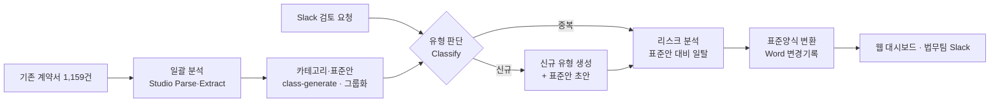

# 처리 흐름과 설계

## 전체 흐름

신규 유형도 표준안 초안을 만든 뒤 **리스크 분석 → 표준양식 변환**을 반드시 거친다.
신규 유형의 표준안은 법무팀 확정 전까지 `draft` 상태로 표시한다.

## Studio 기능과 자체 로직 구분

| 기능 | Studio API | 자체 구현 |
|---|---|---|
| 계약서 읽기·메타데이터 | `document-parse`, `information-extract` | – |
| 결과 적재 | `export`(collection mode) → Collection | – |
| 카테고리 체계 | `class-generate`(Collection 결과 입력) | 그룹 병합, 대표 계약서 선정, 커버리지 집계 |
| 유형 판단 | `document-classify` + 신뢰도 | 기준값 판정('기타/신규' 처리) |
| 신규 유형 등록 | `class-generate`, 새 Config 버전 생성 | 판정→생성→등록 연결 |
| 리스크 분석 | `information-extract`(조항), `instruct`(일탈·리스크), `validate`(금액 기준 등) | – |
| 표준양식 변환·변경기록 | – | .docx 변경 추적(삽입/삭제)·메모 생성 |
| Slack 연동, 화면, 저장 | – | Slack 앱, Next.js, Postgres, Blob |

## Studio 리소스 규칙

- Config는 생성 후 steps를 바꿀 수 없다. 변경은 `studio/` 정의를 고쳐 **새 Config 버전**으로 만든다.
- Agent·Config·Collection ID는 DB `studio_resources`에 저장하고 하드코딩하지 않는다.
- Job은 `background: true`로 실행하고 `GET /v2/responses/{id}`를 폴링한다(`in_progress` → `completed|failed|cancelled`).
