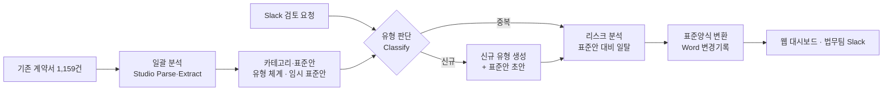

# 처리 흐름과 설계

## 전체 흐름

신규 유형도 표준안 초안을 만든 뒤 **리스크 분석 → 표준양식 변환**을 반드시 거친다.
신규 유형의 표준안은 법무팀 확정 전까지 `draft` 상태로 표시한다.

## Studio 기능과 자체 로직 구분

| 기능 | Studio API | 자체 구현 |
|---|---|---|
| 계약서 읽기·메타데이터 | `document-parse`, `information-extract` | – |
| 결과 적재 | `export`(collection mode) → Collection | – |
| 카테고리 체계 | `class-generate`(Collection 결과 입력) | 그룹 병합, 대표 계약서 선정, 커버리지 집계 |
| 유형 판단 | `document-classify` + 신뢰도 | 기준값 판정('기타/신규' 처리) |
| 신규 유형 등록 | `class-generate`, 새 Config 버전 생성 | 판정→생성→등록 연결 |
| 리스크 분석 | `information-extract`(조항), `instruct`(일탈·리스크), `validate`(금액 기준 등) | – |
| 표준양식 변환·변경기록 | – | .docx 변경 추적(삽입/삭제)·메모 생성 |
| Slack 연동, 화면, 저장 | – | Slack 앱, Next.js, Postgres, Blob |

## Studio 리소스 규칙

- Config는 생성 후 steps를 바꿀 수 없다. 변경은 `studio/` 정의를 고쳐 **새 Config 버전**으로 만든다.
- Agent·Config·Collection ID는 DB `studio_resources`에 저장하고 하드코딩하지 않는다.
- Job은 `background: true`로 실행하고 `GET /v2/responses/{id}`를 폴링한다(`in_progress` → `completed|failed|cancelled`).

## 단계별 구현 메모

### F2 카테고리와 표준안
- 유형 체계: F1 메타데이터 200건 요약을 Studio Chat(구조화 출력)에 넣어 15개 유형과 계약서 배정을 받았다.
  (`class-generate`는 입력 샘플이 Job 1개로 제한되어 전체 체계 설계에는 Studio Chat을 사용)
- 유형 판단 Agent: 위 체계를 `document-classify`의 oneOf 클래스(정의·포함/제외 기준 포함)로 등록하고 `new_type` 클래스를 추가했다.
  200건 재분류 결과가 체계 배정과 **98.5%(197/200)** 일치했다.
- 임시 표준안: 유형별로 대표 계약서(다수 언어 + 법적 조항이 많이 갖춰진 문서)의 원문과 같은 유형 계약서들의 조항 요약을
  Studio Chat에 넣어 국·영문 조항, 가드레일, 일탈 시 리스크·등급을 생성했다. 상태는 `draft`이며 어댑트 25종 원본으로 교체 예정.

### F4 리스크 분석
- Studio Workflow: `Parse → Instruct(Review) → Validate(Verdict)`
  - Instruct는 Config에 지시를 고정하지 않고, 실행 요청의 `input_text`로 해당 유형 표준안과 검토 규칙을 받는다.
    기존 유형·신규 유형 모두 같은 Agent를 쓰고 표준안만 바꿔 넣는다.
  - 응답은 `response_format`(JSON Schema)으로 조항별 `status(일치/일탈/누락/추가조항)`, `severity`, 원문 발췌, 수정 제안(계약서 언어·국문)을 받는다.
  - Validate가 Instruct 결과로 판정한다: 고위험 조항 있으면 red(error), 중위험 또는 1억 원 이상 고액이면 yellow(warning), 그 외 green.

### F5 Word 변경기록
- 표준안의 조항 순서로 문서를 재구성(표준양식 변환)하고, 일탈 조항은 계약서 원문을 **삭제**·수정 제안을 **삽입**으로,
  누락 조항은 표준 문구를 **삽입**으로 기록한다. 각 변경에는 리스크 등급·사유·가드레일을 **메모**로 단다.
- 계약서가 영문이면 영문 표준안으로, 그 외에는 국문으로 만든다. 메모는 항상 국문.
- 다운로드 시 DB의 검토 결과로 즉석 생성한다(`/api/contracts/[id]/redline`).
